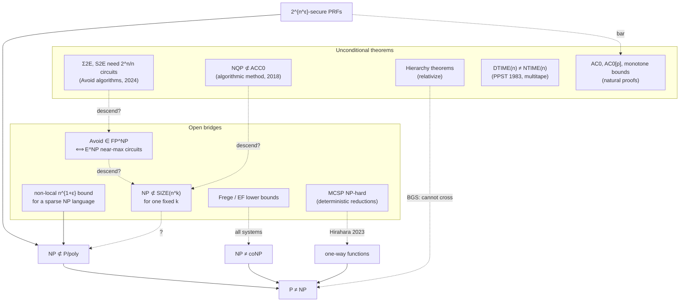

# 6. Attack log: nine attempts and exactly where each one dies

This is the record of my own attempts on the problem during this session, written so that a
reader can see not *that* the problem is hard but *where* it is hard. The rules I held myself to:

1. Every attempt is pushed until it either (a) reduces to a named open problem, (b) runs into one
   of the barrier theorems of `02-barriers.md`, or (c) contains a verifiable error, which is then
   displayed rather than hidden.
2. Nothing below claims a new theorem about P vs NP. Two small facts (§6.4, §6.3) are proved in
   full; they are folklore-level consequences of known results and are labelled as such.
3. "Dies at X" means: continuing would require solving X, and X is listed in `07-open-subproblems.md`.

---

## 6.1 Attempt 1 — Diagonalize directly against P inside NP

**Idea.** The time hierarchy theorem separates $\mathsf P$ from $\mathsf{EXP}$ by a language that, on
input $\langle i,x\rangle$, simulates $M_i(x)$ for $|x|^{\log|x|}$ steps and does the opposite. Try the same
with NP as the diagonalizing class: build $L\in\mathsf{NP}$ that disagrees with every polynomial-time $M_i$.

**Push.** The diagonal language must, on inputs of length $n$ chosen for machine $M_i$, compute
$M_i$'s answer in order to negate it. For a fixed $i$ that costs $n^i$ time; as $i$ ranges over all
indices the cost is unbounded as a polynomial, which is exactly why the construction lands in
$\mathsf{EXP}$ (or $\mathrm{DTIME}(n^{\log n})$) and not in $\mathsf P$. For $L$ to lie in $\mathsf{NP}$ the
negation step must be *verifiable* with a polynomial certificate whose degree does not depend on
$i$. A certificate that lets a fixed-degree verifier confirm "$M_i(x)$ rejects" for an arbitrary
polynomial-time $M_i$ would be a compressed transcript of an arbitrary polynomial computation,
checkable in less time than running it. Deciding whether such certificates exist is a question of
the same type as P vs NP (it is close to asking whether $\mathsf P\subseteq\mathsf{NTIME}(n^{c})$ for a
fixed $c$, which is false by the nondeterministic hierarchy only for the *same* machine model and
not helpful here).

**Where it dies.** Any argument that uses $M_i$ only through simulation applies verbatim to oracle
machines, hence relative to the Baker–Gill–Solovay oracle $A=\mathrm{TQBF}$ where $\mathsf P^A=\mathsf{NP}^A$
(Theorem 2.1). The attempt is not merely difficult; it is impossible as stated. To survive, the
negation step must use a property of $M_i$'s computation that oracle access destroys: its
*locality* (Cook–Levin). But encoding "$M_i$ rejects $x$" as a CNF just produces a SAT instance, and
asking whether that instance is satisfiable is the problem itself.

---

## 6.2 Attempt 2 — Show $\mathrm{SAT}_n$ is "random-like" and therefore hard

**Idea.** Almost every function needs $2^n/n$ gates (Theorem 5.1). Find a measurable sense in which
$\mathrm{SAT}_n$, the Boolean function "is this $n$-bit string an encoding of a satisfiable formula",
resembles a random function, and conclude it is hard.

**Push.** Any such proof exhibits a property $\Phi_n$ of truth tables with (i) $\mathrm{SAT}_n\in\Phi_n$,
(ii) every $f\in\Phi_n$ has large circuit complexity. Property (ii) with "random-like" makes $\Phi$
*large* (a random function has it). If the proof of (i) proceeds by *checking* the property on
$\mathrm{SAT}_n$'s truth table in time $2^{O(n)}$, $\Phi$ is *constructive*, and Theorem 2.2 says such a $\Phi$
cannot exist if $2^{n^\varepsilon}$-secure PRFs exist. So the proof of (i) must be non-algorithmic: it must
show $\mathrm{SAT}_n\in\Phi_n$ by exploiting what SAT *is* (NP-completeness, self-reducibility,
succinct description) rather than what its truth table looks like.

**Where it dies.** Every candidate for $\Phi$ that I can state precisely and prove to be useful
against general circuits is either (a) "$C(f)\ge s$" itself, whose constructivity is the MCSP question
(Proposition 5.2), or (b) a property that known techniques can certify only against restricted
classes ($\mathsf{AC}^0$, $\mathsf{AC}^0[p]$, monotone), where it *is* natural and the barrier does not bite
because those classes cannot compute PRFs. There is no known large property useful against
$\mathsf{P/poly}$ that any explicit function has been proved to possess.

A further observation closes the loop: $\mathrm{SAT}_n$ is maximally *non*-random in every
information-theoretic sense (its Kolmogorov complexity is $O(\log n)$), so "random-like" can only
mean "random-like to bounded-resource observers", i.e. pseudorandom, which is a *stronger*
statement than the lower bound being sought.

---

## 6.3 Attempt 3 — Collapse-based contradiction, and the fixed-polynomial trap

**Idea.** Assume $\mathsf{NP}\subseteq\mathsf{P/poly}$ (or the weaker $\mathrm{SAT}\in\mathrm{SIZE}(n^k)$), derive collapses
(Karp–Lipton: $\mathsf{PH}=\Sigma_2^p$), and look for a contradiction with a known separation.

**Push.** The known unconditional separations are all between classes whose "size" differs by
more than a polynomial ($\mathsf P\ne\mathsf{EXP}$, $\Sigma_2^p\not\subseteq\mathrm{SIZE}(n^k)$, etc.). Here is a derivation
that *appears* to produce a contradiction from $\mathsf{NP}\subseteq\mathrm{SIZE}(n^k)$; I record it because the
error is instructive.

> *Suppose $\mathsf{NP}\subseteq\mathrm{SIZE}(n^k)$. Let $L\in\Sigma_2^p$: $x\in L\iff\exists y\,\forall z\,\phi(x,y,z)$, with
> $|y|=n^a$. The language $A=\{(x,y):\forall z\,\phi(x,y,z)\}$ is in $\mathsf{coNP}\subseteq\mathrm{SIZE}(N^k)$ where
> $N=|x|+|y|\le 2n^a$; let $D_N$ be its circuit. The language $B=\{(x,D):\exists y\,D(x,y)=1\}$ is in
> $\mathsf{NP}\subseteq\mathrm{SIZE}(M^k)$ with $M=|(x,D)|=\tilde O(N^k)$. Hard-wiring $D_N$ into the circuit for $B$ gives
> $L\in\mathrm{SIZE}(\tilde O(n^{ak^2}))$. Hence "$\Sigma_2^p\subseteq\mathrm{SIZE}(n^{O(k^2)})$", contradicting Kannan's theorem
> $\Sigma_2^p\not\subseteq\mathrm{SIZE}(n^{k'})$ for $k'=O(k^2)$. So $\mathsf{NP}\not\subseteq\mathrm{SIZE}(n^k)$ for every $k$.*

**The bug.** The exponent $ak^2$ depends on $L$ through its witness length $n^a$. Kannan's theorem
provides, for each $k'$, *some* $L_{k'}\in\Sigma_2^p$ outside $\mathrm{SIZE}(n^{k'})$, and $L_{k'}$ has witness
length growing with $k'$ (its definition quantifies over circuits of size $n^{k'+1}$). The derivation
proves only $L_{k'}\in\mathrm{SIZE}(n^{a_{k'}k^2})$ with $a_{k'}\ge k'+1$, which does not contradict
$L_{k'}\notin\mathrm{SIZE}(n^{k'})$. The class $\mathrm{SIZE}(n^k)$ is not closed under polynomial-time reductions
with polynomial blow-up; only $\mathsf{P/poly}$ is. This is the whole reason "fixed-polynomial lower
bounds for NP" is a separate open problem from $\mathsf{NP}\not\subseteq\mathsf{P/poly}$: Kannan, Cai ($\mathsf S_2^p$)
and Santhanam ($\mathsf{MA}/1$) spend an *extra quantifier* to name the hard circuit, and NP has no
quantifier to spare.

**Where it dies.** Every collapse theorem I know (Karp–Lipton, Meyer, IKW, Babai–Fortnow–Nisan–Wigderson)
relativizes, so by Theorem 2.1 no combination of them yields $\mathsf P\ne\mathsf{NP}$. The fixed-polynomial
version, $\mathsf{NP}\not\subseteq\mathrm{SIZE}(n^k)$ for a single fixed $k$, is open for every $k\ge1$; it would follow from
$\mathsf{MA}=\mathsf{NP}$ (a derandomization statement) via Santhanam's $\mathsf{MA}/1\not\subseteq\mathrm{SIZE}(n^k)$, which
puts it inside the hardness-vs-randomness ladder of §5.7.

---

## 6.4 Attempt 4 — Win-win case analysis

**Idea.** Kannan's proof and the 2024 Range Avoidance results have the shape "either hypothesis $H$
holds, giving the lower bound directly, or $\neg H$ holds, giving a collapse that can be exploited".
Find a dichotomy whose both branches end in $\mathsf P\ne\mathsf{NP}$.

**Push: a dichotomy that is actually a theorem.**

> **Proposition 6.1 (folklore; consequence of Meyer's theorem).** At least one of the following
> holds: (i) $\mathsf P\ne\mathsf{NP}$; (ii) $\mathsf{EXP}\not\subseteq\mathsf{P/poly}$ (and then also $\mathsf{NEXP}\not\subseteq\mathsf{P/poly}$ and
> $\mathsf P\not\subseteq\mathrm{SIZE}(n^k)$ for every $k$).

*Proof.* Suppose $\mathsf P=\mathsf{NP}$. Then $\Sigma_2^p=\mathsf P$. If $\mathsf{EXP}\subseteq\mathsf{P/poly}$, Meyer's theorem
(in Karp–Lipton 1980; the tableau of an exponential-time computation is described by a polynomial-size
circuit, whose existence and local correctness is a $\Sigma_2^p$ statement) gives $\mathsf{EXP}=\Sigma_2^p=\mathsf P$,
contradicting the time hierarchy theorem. So $\mathsf{EXP}\not\subseteq\mathsf{P/poly}$. Padding gives $\mathsf{NEXP}=\mathsf{EXP}$
under $\mathsf P=\mathsf{NP}$, hence $\mathsf{NEXP}\not\subseteq\mathsf{P/poly}$; and Kannan's $\Sigma_2^p\not\subseteq\mathrm{SIZE}(n^k)$ becomes
$\mathsf P\not\subseteq\mathrm{SIZE}(n^k)$. $\square$

So the two most famous open lower bounds cannot both fail. This is the pattern an attacker wants,
one level too high.

**Trying to push the dichotomy down.** The natural candidate is cryptographic:
*either* one-way functions exist (then $\mathsf P\ne\mathsf{NP}$ immediately) *or* they do not. In the second
branch, by Impagliazzo–Luby every polynomial-time function is invertible on average, and by
Liu–Pass (2020) time-bounded Kolmogorov complexity $K^t$ is easy on average. Can "no OWF" be
driven to $\mathsf P=\mathsf{NP}$, which would make the dichotomy trivial, or to a contradiction? The
strongest known consequences of "no OWF" are average-case easiness statements ($K^t$, and under
NP-hardness-of-meta-complexity hypotheses, DistNP $\subseteq$ AvgP — Hirahara 2023 and successors).
None reaches worst-case $\mathsf P=\mathsf{NP}$: the gap is Impagliazzo's Heuristica, and
Bogdanov–Trevisan / Feigenbaum–Fortnow show it cannot be closed by non-adaptive black-box
reductions. So the branch ends at "NP is easy on average", which is consistent with $\mathsf P\ne\mathsf{NP}$.

**Where it dies.** A win-win ending in $\mathsf P\ne\mathsf{NP}$ needs at least one branch to be
non-relativizing (Theorem 2.1 applies to the whole argument). The non-relativizing tools available
are: arithmetization (algebrizes; by Theorem 2.3 insufficient alone), the easy-witness lemma and the
algorithmic method (which land at $\mathsf{NEXP}/\mathsf{NQP}$), non-black-box worst-to-average reductions
(Hirahara; land at average-case statements), and the single-valued $\mathsf F\Sigma_2\mathsf P$ Avoid algorithms
(land at $\Sigma_2\mathsf E$). Every one of them stops at a class with a spare quantifier or an exponential
time budget. The missing piece is a non-relativizing *polynomial-scale* ingredient.

---

## 6.5 Attempt 5 — Bring the algorithmic method down from NQP to NP

**Idea.** $\mathsf{NQP}\not\subseteq\mathsf{ACC}^0$ is a theorem (Murray–Williams 2018). The method's inputs are an
easy-witness lemma and a non-trivial satisfiability algorithm. Make the quantitative requirements
for $\mathsf{NP}\not\subseteq\mathsf{ACC}^0$ explicit and see which is closest.

**Push.** The accounting in §5.6 shows: for NP, the succinct witness circuit has $m=O(\log n)$ inputs,
so a $2^m/m^{\omega(1)}$ SAT algorithm saves only a $(\log n)^{\omega(1)}$ factor, while the easy-witness lemma
costs polynomial factors. Three options:

- (i) *Polynomial savings on $O(\log n)$-input circuits.* Means deciding satisfiability of a
  $\mathrm{poly}(n)$-size circuit on $\log n$ inputs in time $n^{1-\varepsilon}$, less than the time to read the circuit.
  Impossible in the standard model. (A *compressed* representation of the witness circuit could
  evade this, but then the circuit class must be compressible, which $\mathsf{ACC}^0$ is not known to be.)
- (ii) *An easy-witness lemma with polylogarithmic overhead.* The Murray–Williams lemma's
  polynomial loss comes from the Karp–Lipton-style search for the witness circuit. I do not know a
  barrier that forbids a sharper lemma, and I did not find a route to one; it would be a strong
  statement about the *structure* of NP witnesses under the hypothesis $\mathsf{NP}\subseteq\mathrm{SIZE}(n^k)$.
- (iii) *Replace the hierarchy theorem by magnification.* Chen–Jin–Williams (2019): if some
  $2^{n^{o(1)}}$-sparse language in NP requires circuits of size $n^{1+\varepsilon}$, then
  $\mathsf{NP}\not\subseteq\mathrm{SIZE}(n^k)$ for all $k$. The required $n^{1+\varepsilon}$ bound is *below* what we can prove for
  some explicit functions in other models, but the locality barrier (Theorem 2.4) shows the sparse
  targets have $n^{1+o(1)}$-size circuits once oracle gates of fan-in $n^{o(1)}$ are allowed, and
  every known technique for this regime is oblivious to such gates.

**Where it dies.** Option (iii) reduces to: *find a lower-bound technique for near-linear-size
circuits that is not local*, i.e. that uses the fact that the sub-circuits feeding a gate cannot
compute arbitrary functions of $n^{o(1)}$ bits. No such technique exists; every known one argues
about restrictions and sub-function counts, which oracle gates do not disturb.

---

## 6.6 Attempt 6 — $\mathsf{NP}\ne\mathsf{coNP}$ through proof complexity

**Idea.** By Cook–Reckhow (Theorem 5.5) it suffices to prove superpolynomial lower bounds for every
propositional proof system. Find a tautology family hard for all systems at once.

**Push.** Lower bounds exist for Resolution, bounded-depth Frege, Cutting Planes, Polynomial
Calculus and Sum-of-Squares; they are open for $\mathsf{AC}^0[p]$-Frege, Frege and Extended Frege, and
the method that produced most of the known bounds (feasible interpolation) provably fails for
Frege-type systems if factoring is hard (Krajíček–Pudlák; Bonet–Pitassi–Raz). For "every system",
a family hard for all systems is equivalent (Krajíček) to the non-existence of an optimal proof
system plus more, and the only candidates are *proof complexity generators*: tautologies
$\tau_b(g)$ asserting that $b$ is outside the range of a stretching map $g:\{0,1\}^n\to\{0,1\}^{n+1}$. Note
that this is literally Korten's Range Avoidance problem viewed from the proof side: a solution to
Avoid is a $b\notin\mathrm{rng}(g)$, and a lower bound for $\tau_b(g)$ in a system $P$ says $P$ cannot
efficiently certify such solutions. The 2026 results reported in `03-frontier-2026.md`
(demi-bits $\Rightarrow$ generators $\Rightarrow$ Avoid hardness) make the two programs one program.

**Where it dies.** Frege lower bounds. Nothing in this attempt gets past the system that the
community has been stuck on since the 1980s; and even Frege is one system, while Cook–Reckhow
demands all of them. The only route that handles all systems at once is a *cryptographic* one
(generators secure against all systems), whose assumptions already imply $\mathsf P\ne\mathsf{NP}$.

---

## 6.7 Attempt 7 — A purely uniform separation (no circuits at all)

**Idea.** $\mathsf P\ne\mathsf{NP}$ is a uniform statement. Avoid the natural-proofs barrier entirely by
proving a *time* lower bound for SAT on Turing machines, in the style of the known time-space
tradeoffs.

**Push.** The only unconditional uniform separations near NP: Paul–Pippenger–Szemerédi–Trotter
(1983), $\mathrm{DTIME}(n)\subsetneq\mathrm{NTIME}(n)$ for multitape machines, and the SAT time-space tradeoffs
$\mathrm{SAT}\notin\mathrm{TISP}(n^{c},n^{o(1)})$ for $c<2\cos(\pi/7)$. Both use *model-specific* structure
(block-respecting computations and separators; alternation trading with speedup theorems for
space-bounded machines). PPST does not extend beyond linear time; its proof depends on the
geometry of multitape computations and it is not even known for RAMs. The alternation-trading
template cannot pass $2\cos(\pi/7)$ (Buss–Williams 2012), and it needs a space bound to get the
speedup step started. Williams (2025), $\mathrm{TIME}[t]\subseteq\mathrm{SPACE}[\sqrt{t\log t}]$, is a new speedup
theorem, but it trades time for *space*; feeding it into the alternation-trading template gives
time-vs-space separations, not time-vs-nondeterministic-time ones, and the template's ceiling is unchanged.

**Where it dies.** No speedup theorem of the form $\mathrm{TIME}[t]\subseteq\Sigma_2\mathrm{TIME}[t^{1-\varepsilon}]$ is
known without a space restriction, and the indirect-diagonalization template is formally bounded
below $n^2$ even with one. A uniform proof of $\mathsf P\ne\mathsf{NP}$ would need a qualitatively new way of
compressing deterministic computation that oracle access destroys; the only such compression
known (Cook–Levin + arithmetization) algebrizes.

---

## 6.8 Attempt 8 — Meta-complexity self-reference

**Idea.** $\mathrm{MCSP}\in\mathsf{NP}$. If MCSP were in P, then (Proposition 5.2) no secure PRFs exist, so by the
contrapositive of the natural-proofs barrier *natural proofs become available*; if MCSP is not in P
then $\mathsf P\ne\mathsf{NP}$ outright. Exploit the self-reference.

**Push.** Case MCSP $\notin\mathsf P$: done. Case MCSP $\in\mathsf P$: natural proofs are not barred, and
"$C(f)\ge s$" is P-constructive and large, i.e. a P-natural property useful against $\mathrm{SIZE}(s)$
exists. But a natural property's existence does not by itself give a lower bound for an *explicit*
function; we would still need to show $\mathrm{SAT}_n\in\Phi_n$, i.e. $C(\mathrm{SAT}_n)\ge s$ — and in this
case we have an algorithm (the MCSP algorithm) that could in principle *compute* $C(\mathrm{SAT}_n)$, but
knowing how to compute a number is not knowing that it is large. The branch therefore ends at the
original question. Worse, in the world $\mathsf P=\mathsf{NP}$ everything in this attempt is consistent:
MCSP is in P, there are no PRFs, natural properties exist, and $C(\mathrm{SAT}_n)=\mathrm{poly}(n)$.

**The consistent-world principle.** Every implication chain in meta-complexity — "MCSP easy
$\Rightarrow$ no OWF", "MCSP NP-hard $\Rightarrow$ OWF iff NP hard on average", "$K^t$ hard on average
$\Leftrightarrow$ OWF" — holds *vacuously or consistently* in the world $\mathsf P=\mathsf{NP}$. Therefore no
chain of implications can refute $\mathsf P=\mathsf{NP}$ unless some link is an unconditional lower bound.
The unconditional lower bounds we have are: hierarchy theorems (relativizing), $\Sigma_2\mathsf E\not\subseteq\mathrm{SIZE}(2^n/n)$,
$\mathsf{NEXP}/\mathsf{NQP}\not\subseteq\mathsf{ACC}^0$, PPST, and the $\mathsf{AC}^0/\mathsf{AC}^0[p]$/monotone bounds. A proof must
start from one of these and build a non-relativizing bridge to NP.

**Where it dies.** At the same place as Attempt 4: a polynomial-scale non-relativizing bridge.

---

## 6.9 Attempt 9 — Learn from the newest unconditional result (Range Avoidance)

**Idea.** The 2024 theorems $\Sigma_2\mathsf E,\mathsf S_2\mathsf E\not\subseteq\mathrm{SIZE}(2^n/n)$ came from a single-valued
$\mathsf F\Sigma_2\mathsf P$ algorithm for Avoid. Ask for the NP-level analogue.

**Push.** A hard truth table is a solution to Avoid for the "truth-table generator" circuit that
maps circuit descriptions of size $2^n/(2n)$ to their $2^n$-bit truth tables (the map stretches, so
most strings are outside its range). Hence: Avoid $\in\mathsf{FP}$ would give explicit hard functions in
$\mathsf E$; Avoid $\in\mathsf{FP}^{\mathsf{NP}}$ gives $\mathsf E^{\mathsf{NP}}$ hard functions (Korten 2021), and this is
*equivalent* to $\mathsf E^{\mathsf{NP}}$ requiring near-maximum circuits; Li (2024) achieves the
$\mathsf F\mathsf S_2\mathsf P$ version. The NP analogue would be a single-valued $\mathsf{FNP}$ algorithm for Avoid, i.e.
an NP-verifiable canonical non-image. The reported 2026 results cut both ways: Avoid is
unlikely to be NP-hard (Ghentiyala–Li–Stephens-Davidowitz: $\mathsf{BPP}^{\mathrm{Avoid}}\subseteq\mathsf{AM}\cap\mathsf{coAM}$),
and the Li-style technique provably cannot solve the strong, stretch-$(n+1)$ version
(Korten–Pitassi 2024). Avoid lives in an intermediate zone, like factoring or graph isomorphism.

**Where it dies.** Even full success — Avoid $\in\mathsf{FP}^{\mathsf{NP}}$ — yields $\mathsf E^{\mathsf{NP}}\not\subseteq\mathrm{SIZE}(2^n/n)$,
an exponential-time class. The descent from $\mathsf E^{\mathsf{NP}}$ to $\mathsf{NP}$ is the same missing bridge.
What this attempt *does* clarify is that the frontier is now an **explicit construction problem**:
P vs NP has been pushed, by the field, to the question of how much nondeterminism is needed to
*name* a hard object.

---

## 6.10 What the nine attempts have in common

Every solid arrow is a theorem; every dashed arrow is open or barred. All nine attempts end at a
dashed arrow in the lower half of this picture, and the dashed arrows have one shared feature:
each asks for a non-relativizing, non-algebrizing, non-natural, non-local argument that operates
at *polynomial* scale. The techniques that evade the barriers currently require an exponential time
budget or a spare quantifier to pay for the witness search that they use to contradict a hierarchy
theorem. This dossier's ranked program (`04-attack-vectors.md`) is organized around removing that
overhead, because it is the one obstacle that every live approach shares.
